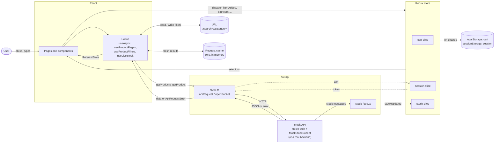

# Architecture

How The Bug Bazaar is put together: where the code lives, how data moves through it, and
where each kind of state is kept.

## Folder structure

```text
src/
  main.tsx          Starts the app: store, router, outer error boundary
  app/              App shell: header, footer, routes, page error boundary
  api/              The only code that talks to the server
    client.ts         apiRequest() for HTTP, openSocket() for WebSockets
    products.ts       getProducts, getProduct, and the URL format for filters
    orders.ts         createOrder (with the idempotency key), getOrder
    auth.ts           login, getCurrentUser
    stock-feed.ts     The live stock connection: subscribe, reconnect with backoff
    error-messages.ts Maps any API error to what the user sees
    types.ts          The API contract as TypeScript types
  features/         One folder per feature, with its pages, components, hooks and tests
    products/         Shop list, filters, product details, virtual grid
    cart/             Cart slice and cart page
    checkout/         Checkout page
    orders/           Order confirmation page
    session/          Session slice, login, account, RequireAuth
    stock/            Live stock slice, useLiveStock, the "Live stock" status
  shared/           Used by more than one feature: useAsync, request cache, status views,
                    error boundary, monitoring, small hooks
  store/            Redux store, typed hooks, saving to localStorage/sessionStorage
  mocks/            The mock API: mockFetch, the mock socket, handlers, seeded data,
                    the Mock API controls panel
  styles/           CSS, one file per area, imported in order from index.css
  test/             Test setup and renderApp()
docs/               Written tasks
.github/workflows/  CI on every pull request, deploy to GitHub Pages from main
```

Two rules keep this tidy:

- **Features don't reach into each other's internals.** A feature imports another
  feature's slice actions and selectors (the product card dispatches `itemAdded` from
  `cart/`), but shared building blocks go in `shared/`.
- **Only `src/api/` talks to the network.** Lint blocks `fetch`, `XMLHttpRequest` and
  `WebSocket` everywhere else.

## Data flow



Reading it as three paths:

1. **Loading server data (products, an order).** A page calls a hook, the hook calls a
   function in `src/api/`, and that goes through `apiRequest()`. The result comes back as a
   `RequestState` (`loading`, `error` or `success` with data), and `AsyncContent` picks the
   right view for it. Results are kept in the request cache for 60 seconds.
2. **Changing client data (cart, sign-in).** A component dispatches an action, the slice's
   reducer updates the store, and every component that selected that value renders again.
   The store saves the cart and the session to browser storage when they change. The API
   client reads the token from the session, and a 401 dispatches `sessionExpired`.
3. **Live stock.** `useLiveStock` opens a WebSocket through `openStockFeed`. Each message
   dispatches `stockUpdated`, and a product card reads its stock with `selectStock`, which
   prefers the live value over the fetched one.

### Example: adding a product to the cart

1. The user presses **Add** on a product card.
2. `ProductCard` dispatches `itemAdded({ ...product, stock })`, using the live stock if there
   is one.
3. The cart reducer adds the line, or adds 1 if it's below stock, and clears the checkout key
   (it's a different order now).
4. The header badge (`selectCartCount`) and that card's button (`useQuantityInCart`) render
   again. No other card does: `memo` and number selectors keep them out of it.
5. The store's subscriber sees a new `cart` object and writes it to `localStorage`.

No request is sent. The server checks stock again when the order is placed.

## Where each kind of state lives

| Kind                | What                                                     | Where                                                                   | Why there                                                                                     |
| ------------------- | -------------------------------------------------------- | ----------------------------------------------------------------------- | --------------------------------------------------------------------------------------------- |
| **Server state**    | Products, product details, orders, the current user      | Fetched by `useAsync` / `useProductPages`, cached in `request-cache.ts` | The server owns it. We keep a copy, decide how stale it may be (D3-5), and fetch it again     |
| **Server state**    | Live stock levels                                        | Redux `stock` slice, never saved                                        | Several components read it and it changes all the time, so selectors keep re-renders per card |
| **Client state**    | The cart, with its checkout (idempotency) key            | Redux `cart` slice, saved to `localStorage`                             | Only the browser knows it. It should survive a reload and be there tomorrow                   |
| **Client state**    | The session (token and user)                             | Redux `session` slice, saved to `sessionStorage`                        | Needed by the API client and the header. Ends when the tab closes (see `auth.md`)             |
| **URL state**       | Search, category, in stock, sort                         | Query string, read and written by `useProductFilters`                   | Survives a refresh, can be shared as a link, works with Back                                  |
| **URL state**       | Which product or order (`/products/:id`, `/orders/:id`)  | Route path, read with `useParams`                                       | Same reasons, and each page has its own address                                               |
| **Component state** | Form fields, "placing your order…", which rows are drawn | `useState` / `useRef` in the component                                  | Nothing else needs it, and it should reset when you leave the page                            |

The rule behind the table: **each piece of data has one owner.** Products are never copied
into Redux, filters are never copied into state, and the cart badge count is calculated
from the cart lines instead of being stored next to them.

## One choice we'd defend: server data is not in Redux

The brief asks for Redux Toolkit, and the easy path would be to put everything in it:
products, the loading flags, the current page. We didn't.

- **What lives in Redux:** only what the browser owns (cart, session) and the live stock
  values, which arrive from a socket rather than from a request.
- **What doesn't:** products and orders. They are fetched by `useAsync`, which aborts old
  requests, ignores stale replies (D2-6) and caches results for 60 seconds (D3-5).

Why:

- **Server data has a different life.** It can be stale, it has to be fetched again, and
  two requests can race. Redux has none of that built in. We would have to write loading
  flags, cancel logic and cache expiry into reducers by hand.
- **Fewer copies, fewer bugs.** If products were in Redux and in the cache, they could
  disagree. With one owner, the product list and the details page can't show two different
  prices.
- **Redux stays small and easy to read.** Three slices, every action a named event.

The cost: there's no single place to see all the app's data in Redux DevTools, and each page
fetches its own data. If more pages shared the same server data, we'd move it to RTK Query
(Redux Toolkit's data-fetching layer) instead of writing more of our own cache. See D3-5 in
`decisions.md`.

## Design patterns

### 1. Custom hooks

- **Where:** `useAsync`, `useProductPages`, `useProductFilters`, `useLiveStock`,
  `useVirtualRows`, `useDebouncedValue`, `useEventListener`, `useQuantityInCart`.
- **What it is:** a function that starts with `use` and combines React's own hooks (state,
  effects, refs) into one behaviour with a small, typed result.
- **Why:** the tricky parts are written and tested once. Every effect that needs cleanup
  (aborting a request, closing a socket, removing a listener, disconnecting an observer)
  lives inside a hook, so a page can't forget it. Pages read like a description of what
  they show:

  ```ts
  const { filters } = useProductFilters()
  const products = useProductPages(filters)
  const liveStatus = useLiveStock(watchedIds)
  ```

### 2. Container and presentational components

- **Where:**
  - **Containers** know where data comes from: the pages (`ProductListPage`,
    `ProductDetailsPage`, `OrderConfirmationPage`, `CheckoutPage`). They call hooks, read
    the store and decide what to do.
  - **Presentational** components only get props and render them: `AsyncContent`,
    `ErrorState`, `EmptyState`, `LoadingGrid`, `LoadingDetails`, `ApiErrorView`,
    `LiveStockStatus`.
- **Why:** the views can be used on any page, and they look the same everywhere. Every page
  that loads data hands its `RequestState` to `AsyncContent`, so none of them can forget the
  loading or error state (D2-3).
- **Where we bent it:** `ProductCard` reads its own stock and cart quantity from the store
  instead of getting them as props. With 5,000 products, passing them down would make the
  whole grid render again on every cart change. Reading them in the card means only that
  card renders (D4-2, D4-4).

### 3. Adapter

- **Where:**
  - `src/api/client.ts`: `send` is either the browser's `fetch` or `mockFetch`, which has
    the same signature and returns a real `Response`. `openSocket()` returns either a
    `WebSocket` or `MockStockSocket`, both shaped as our `LiveSocket` interface.
  - `src/api/error-messages.ts`: turns any `ApiRequestError` (status, code, details) into
    one of six kinds and the words the user sees.
- **What it is:** a layer that makes something fit the shape the rest of the code expects,
  so the rest of the code doesn't care what's behind it.
- **Why:** pages, hooks and tests don't know if the backend is real. Switching to a real
  server is one environment variable (`VITE_USE_MOCK_API=false`), with no change to any
  component. In the same way, no page reads status codes: they ask `errorKind(error)` and
  get `'out-of-stock'` or `'offline'`.

Two smaller ones, for completeness:

- **Error boundary:** `ErrorBoundary` catches render errors around each page and around the
  whole app (D4-7).
- **Observer:** the store's `subscribe` (saving the cart), the stock feed's event listeners,
  and the `IntersectionObserver` that loads the next page.
