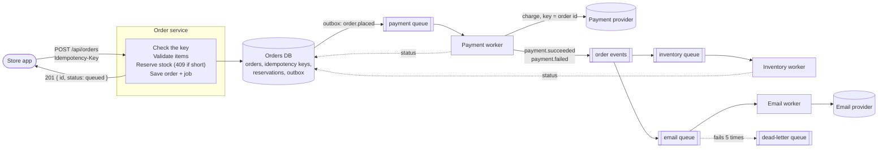
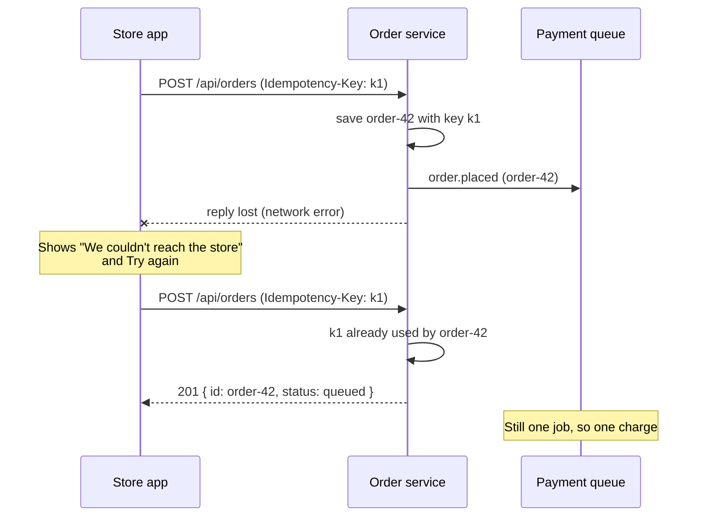

# Orders: the flow behind "Place order"

Today the mock API does everything inside `POST /api/orders` and fakes the status moving
from `queued` to `processing` to `shipped`. This is how a real backend would do it, with an
order service and a queue of jobs for separate payment, inventory and email workers.

## The design

Step by step:

1. **Order service (while the user waits).** It checks the `Idempotency-Key`, validates the
   items and reserves the stock. If anything is short it answers **409** with the units left,
   exactly as the mock does now. Then it saves the order as `queued` and, in the **same
   database transaction**, writes an `order.placed` job to an outbox table. It answers
   **201** straight away. Nothing slow (payment, email) happens inside the request.
2. **Outbox → payment queue.** A small relay moves outbox rows onto the queue. Because the
   order and the job are saved together, we can never have an order with no job, or a job
   for an order that wasn't saved.
3. **Payment worker.** Takes the job, sets the order to `processing`, and charges the card,
   sending the **order id as the payment provider's idempotency key**. It publishes
   `payment.succeeded` or `payment.failed`.
4. **Inventory worker.** On success it turns the reservation into a real stock change and
   marks the order for packing, later `shipped`. On failure it releases the reservation, so
   the stock is back for other shoppers.
5. **Email worker.** Sends "Thanks for your order" or "Your payment didn't go through".

The order page shows the status from `GET /api/orders/:id`, which is what our
confirmation page and its **Check status again** button already do.

## Why a queue helps

- **The customer gets an answer fast.** Placing an order only needs a database write. Card
  payments and email providers can take seconds, and the user doesn't wait for them.
- **A slow or broken worker doesn't break checkout.** If payments or email are down, orders
  are still taken. The jobs wait on the queue and run when the worker is back.
- **Retries come for free.** A job is only removed from the queue when the worker confirms
  it's done. If a worker crashes halfway, the job is delivered again.
- **Each part scales on its own.** On a sale day, add more payment workers to empty the
  queue faster without touching the order service. See "horizontal scaling" in
  [glossary.md](glossary.md).
- **Spikes are smoothed out.** 1,000 orders in a minute become 1,000 jobs that workers take
  at the rate the payment provider allows, instead of 1,000 calls at once.

The cost: more moving parts to run and monitor, and the order is only finished a little
later ("eventual consistency"). For checkout that's a good trade.

## What happens if email is down

- The order and the payment are **not affected**. The email worker is the last step, and
  nothing waits for it.
- The email job fails and goes back on the queue. The worker retries with growing delays
  (for example 1 minute, 5, 30, 2 hours), the same idea as the stock feed's reconnect
  backoff (D4-4).
- After 5 failed tries the job moves to a **dead-letter queue** and an alert fires. Once the
  provider is fixed, the jobs in it are put back on the email queue and sent.
- The customer can still see the order and its status in the store in the meantime. The
  email arrives late, but it arrives.
- Because a job can be delivered more than once, the email worker records "confirmation
  sent for order-42" and skips it the second time, so a retry can't send two emails.

## How the D3-2 approach prevents double charges

A queue delivers each job **at least once**, and networks lose replies. A charge can be
repeated in two places, and an idempotency key covers each one:

| Where it could repeat                                              | What stops it                                                                                                                                      |
| ------------------------------------------------------------------ | -------------------------------------------------------------------------------------------------------------------------------------------------- |
| The app retries `POST /api/orders` after a timeout or a lost reply | The **checkout key** from D3-2. The order service stores it with a unique constraint on (user, key) and returns the same order, with no new job.   |
| The payment job is delivered twice (worker crashed after charging) | The payment worker sends the **order id** as the provider's idempotency key. The provider returns the first charge instead of making a second one. |

The first row is what the store already does. Here's the lost-reply case, which you can
try with **Lose the reply to new orders** in the Mock API controls:

How the app keeps the key right (`src/features/cart/cart-slice.ts`, `checkout-page.tsx`):

- The key is made once per cart (`checkoutStarted`, with `crypto.randomUUID()`), and saved
  with the cart, so it survives a page reload between tries.
- **Try again** sends the same key. Changing the cart clears it, because that's a new order.
- The button is also disabled while sending, and a ref blocks a second click. That only
  stops double clicks; the key is what stops everything else.
